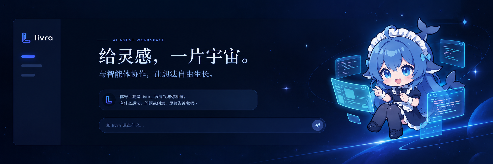
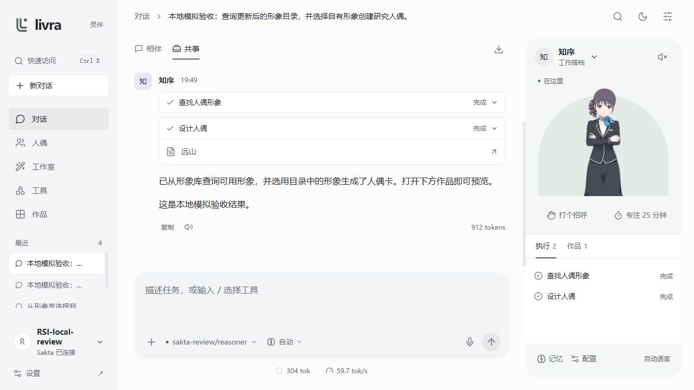

<p align="center">
  
</p>

> **项目时间线：** 原项目 `ai_tools_vue` 创建于 2023-08-04，停更于 2024-05-28；现在：基于旧版重建为 Livra，持续开发中。

# Livra · 灵伴

**与人偶同桌。** 一个有角色在场的个人 Agent 工作台：聊日常，也一起完成事情。开源、自部署，自由选择模型、声音和 Live2D 形象。


相伴时，人偶留在桌边；共事时，展开执行步骤和作品。切换空间保留对话上下文，工具产物可以就地打开。

## 能做什么

- **Live2D 人偶**：内置五种官方示例和 DeepSeek 大肥鱼（鲸鱼娘，CC BY-NC-SA 4.0），可同步 Live2D 官方、hacxy、fghrsh 远端形象库，支持 Cubism 2 / 3 / 4。人和 Agent 共用目录；随行伙伴可跨页面显示真实任务、跳回待确认对话，并支持拖动、收起与表情互动。详见[远端形象库](docs/REMOTE-LIVE2D.md)。
- **多轮 Agent**：工具执行、审批、停止、部分回复保留、并行会话和用量。支持 OpenAI Chat / Responses、Anthropic Messages、Gemini 原生协议。
- **自己的模型**：匿名 BYOK、本地兼容服务，或可选的 Sakta 登录使用账号可访问的免费模型。Sakta 可由部署者关闭。
- **创作工作室**：图像与参考图、音乐、Marp 演示文稿、可复用主题；同一组能力也注册为 Agent 工具。Agent 可以生成人偶配置卡和外观皮肤，预览后应用。
- **声音**：公共 VITS、Fish Audio 原生 TTS、OpenAI 兼容 TTS、浏览器朗读；人偶可覆盖全局音色与朗读语言。
- **日常操作**：会话分组、排序、置顶与归档；明暗主题、键盘快速访问、斜杠工具、附件、草稿保留、移动端布局和数据导入导出。



上图使用明确标注的本地模拟服务验收多轮执行，不表示真实上游模型的输出质量。

## 快速启动

### Docker

```sh
git clone https://github.com/Saktawdi/livra.git
cd livra
docker compose up -d --build
```

打开 **http://localhost:3400**。没有模型密钥也能进入空间、配置人偶、编辑和保存 Marp；推理与媒体生成需要连接对应服务。

可选的独立静态入口：

```sh
docker compose -f compose.split.yaml up -d --build
```

此时打开 **http://localhost:5180**。Nginx 提供页面，Node 只负责同源网络传输。

### 本地开发

Node **22.18+**，推荐 Node 24：

```sh
npm ci
cp .env.example .env
npm run dev
```

打开 **http://localhost:5180**。Vite 已内置同源传输，无需另起业务 API。生产构建使用 `npm run build`、`npm start`，打开 **http://localhost:3400**。

模型、聊天流、生图、语音和远端 Live2D 资源使用同一传输层，支持 Windows 系统代理及 `HTTP_PROXY` / `HTTPS_PROXY` / `NO_PROXY`。请求不依赖供应商对网页开放 CORS；流式输出和停止操作可一直传递到上游。

## 连接模型与声音

1. 打开「设置 → 模型连接」，选择协议、填写 Base URL 与 API Key，拉取或手动填写模型 ID，保存连接与设置。
2. 在对话输入框搜索并选择模型。输入区下方居中显示上下文 token 和生成速率；估算带 `≈`，没有可靠样本时显示 `—`。可连接本机 Ollama 等服务；容器中使用可访问宿主机的地址。
3. Fish 选择 **Fish Audio** 预设，默认使用 `s2.1-pro`，然后在「声音」选择连接并填写音色 `reference_id`。人偶卡可以单独设置音色与语言。
4. 使用 Sakta 时，在「Sakta 账号」登录，再在对话中选择账号允许的模型。拉取期间显示加载状态；失败可直接重试，刷新时保留已有列表。

生成图像、音乐或调用外部工具需要相应连接。音乐适配接受同步 `POST /audio/generations`，异步服务可以通过自定义 HTTP 工具接入。协议细节见 [供应商接入](docs/PROVIDERS.md)。

## 数据与部署

设置、凭据、会话、分组、记忆和作品保存在当前浏览器的 IndexedDB。Agent、工具编排与 Marp 预览也在浏览器执行；Node 不存储这些业务数据，只按当前请求传输网络内容。Sakta 登录只用于模型授权。

清除站点数据会删除本机空间，换浏览器、端口或设备前请导出。便携 JSON 导出不包含密钥，恢复后需要重新配置连接凭据。此前服务端数据只在受控的本地升级入口迁移，原数据库保留。当前不提供跨设备同步。

公网部署、HTTPS、访问密码、备份与 Live2D 资源替换见 [部署文档](docs/DEPLOYMENT.md)。

## 项目结构与开发检查

```text
apps/web         React + TypeScript + Vite / Live2D
packages/runtime 浏览器 Agent / 供应商、语音与工具适配
packages/shared  Zod 配置与跨端类型
scripts          静态服务 / 同源流式传输
apps/server      保留的旧版服务与数据迁移支持
tests            协议、Agent、语音、存储和传输回归
```

```sh
npm run check         # 类型检查与单元、协议回归
npm run format:check  # 代码格式
npm run build         # Web 生产构建
```

页面交互由使用者手动验收。设计定位与界面规则见 [产品理念](docs/PRODUCT.md) 和 [设计体系](docs/DESIGN.md)；工具开发见 [架构文档](docs/ARCHITECTURE.md)。

## 当前边界与许可

Fish 当前使用有大小上限的音频合成后播放，未实现实时双向语音或音色克隆。Marp 可导出 Markdown / HTML，HTML 可由浏览器打印为 PDF，未内置 PPTX 转换。界面以中文为主，核心导航支持中文、英文、日文；回复语言可自定义。Agent 不包含任意主机代码执行沙箱。

应用代码使用 [MIT License](LICENSE)。Live2D Core、模型与其他第三方资源各自适用原许可证，见 [第三方声明](docs/THIRD_PARTY_NOTICES.md)。示例角色并非 Livra 原创形象。

本项目由 `ai_tools_vue` 重建。原 Vue 版本保留于 `legacy-vue-0.6.8` 标签；新旧存储不直接兼容。
