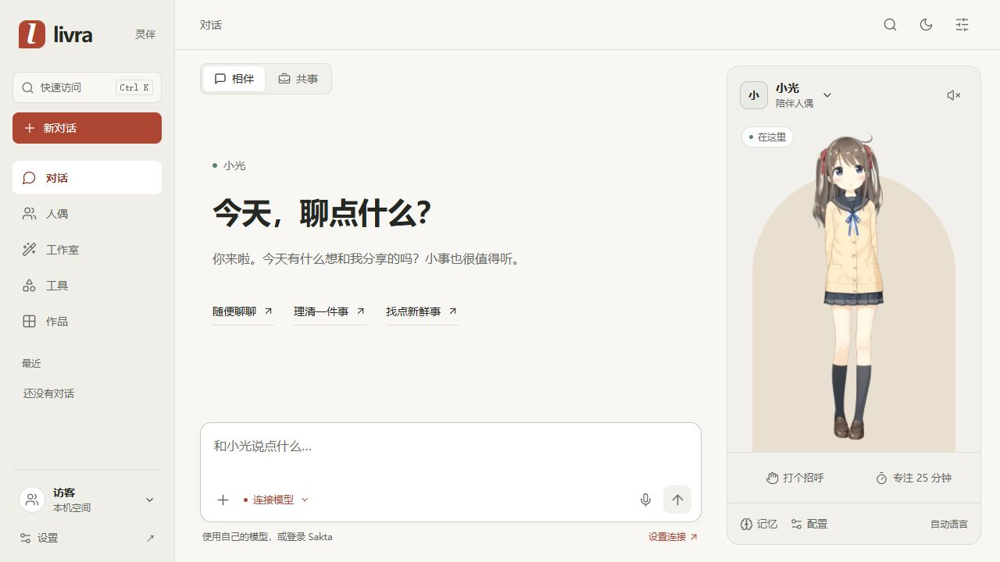
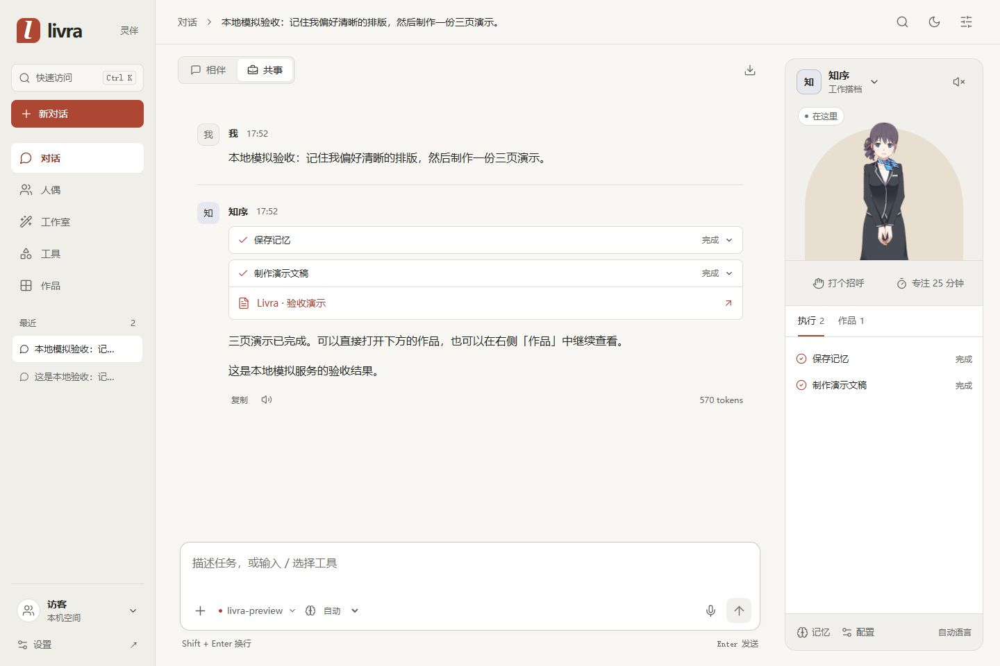

# Livra 产品设计体系

## 组织原则

**与人偶同桌**意味着三件事：有稳定的回应者，交流能连续走向执行，结果留在当前工作上下文中。视觉、布局、文案与动效都服务这三个行为。

这套体系不以科幻、拟物或极简作为先决风格。纸色的桌面、窗形舞台和克制的操作层级，为长时间交流与工作提供空间；角色是情感焦点，作品是任务焦点。

## 空间语法

| 元素 | 产品含义 | 实现规则 |
| --- | --- | --- |
| 左侧导航 | 用户自己的空间与历史 | 保持五个主要去向，历史支持置顶、改名；手机变为可退出的抽屉 |
| 对话桌面 | 从交流到完成任务的连续记录 | 用户、回复、工具、审批、作品共用一条时间顺序；不把执行信息藏在另一个页面 |
| 窗形舞台 | 有角色在场 | 相伴使用完整舞台；共事采用半身形象，将空间让给执行与作品 |
| 相伴 / 共事 | 当前协作关系 | 切换实际人偶与工具能力，保留会话；运行期间禁止切换 |
| 作品预览 | 一次任务的可用结果 | 从工具记录或右侧作品直接打开，关闭回到原入口；源文件与成品导出分开命名 |
| 工作室画布 | 对结果进行主动创作 | 控制与预览并排；手机顺序排列；保存动作保持可达，文字草稿跨切页与刷新保留 |

## 视觉语法

- **纸面与石墨**：暖白承托内容，石墨区分正文与辅助层。深色保留同样的层级关系。
- **朱砂**：用于当前操作、选择与确认；错误另外使用危险色，并始终有文字状态。
- **窗形只用于人偶**：不把每个信息块都变成同样的圆角卡片。任务入口用行、工具用执行条、作品用画布。
- **字体首先清晰**：系统无衬线中文；会话 16px / 1.75，操作 14px，辅助 13px，非关键时间最小 12px。禁止文字容器滤镜、细字、整体 opacity 与缩放排版。
- **边界表达关系**：4px 间距网格，常用圆角 10–16px，明暗通过表面与边线分层；不依赖大面积发光和渐变装饰。

基础正文与辅助色在主要浅色表面上的对比度分别至少 12.99:1、5.05:1；最弱的时间文字色至少 4.55:1。图标、禁用控件和示例模型纹理不按正文对比度计算。动态生成的作品有自己的内容样式。

## 行为语法

| 用户意图 | 反馈与退出方式 |
| --- | --- |
| 和人偶互动 | 问候反馈、目光跟随、结构化情绪；状态文字区分思考、执行、声音准备与播放，不以文本流假装语音 |
| 发出任务 | IME 组合输入不误发送；Enter 发送、Shift+Enter 换行；提交失败带回草稿 |
| 使用工具 | 展示工具名称与运行状态；需要批准时先展示实际写入内容或生成描述，JSON 参数按需展开 |
| 停止或遇错 | 停止按钮取消上游并保留部分回复；失败消息可带回输入框编辑后重试，不自动重复有副作用的工具 |
| 查找入口 | Ctrl/Cmd+K 聚焦快速访问输入框；方向键选项、Enter 执行、Esc 退出并恢复焦点 |
| 阅读历史 | 新回复不抢走已滚动的位置；提供回到最新回复入口 |
| 专注 | 25 分钟计时可暂停、继续、结束；切页保持时间，不依赖后台定时器准确唤醒 |

过渡集中在 140–220ms，作用是确认选择、提示执行和空间层级。系统或应用的减少动态偏好关闭非必要过渡；不可用、加载与失败状态均以真实状态显示。

## 可访问与响应式规则

使用有标签的表单、原生对话框、可见焦点和键盘退出。手机抽屉与主内容互斥进入焦点序列。375px 保持正文和操作可读，不通过缩小整页解决布局；768px 以单一对话区为主、人偶按需打开；大屏同时展示对话与舞台。

## 产品与工程对应

人偶配置将人格、语言、音色、情绪映射和工具授权放在一个模型中；Agent 注册表同时供对话与工作室使用；作品采用统一存储与预览。前端只处理交互，后端处理凭据、执行与持久化。设计状态直接来自 Agent / 音频生命周期，不另外制造虚假进度。

本轮验收与仍存在的边界见 [RSI.md](RSI.md)。
